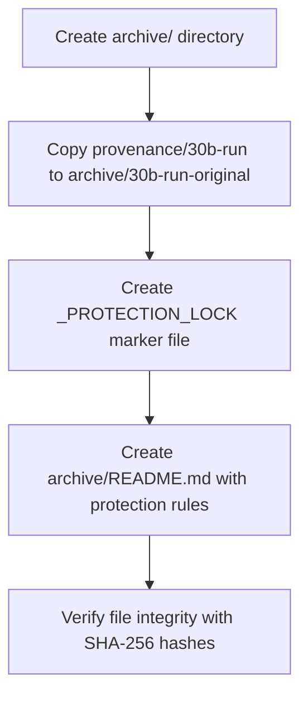
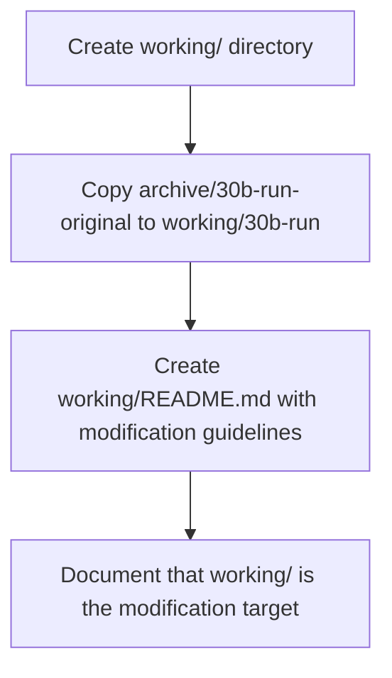
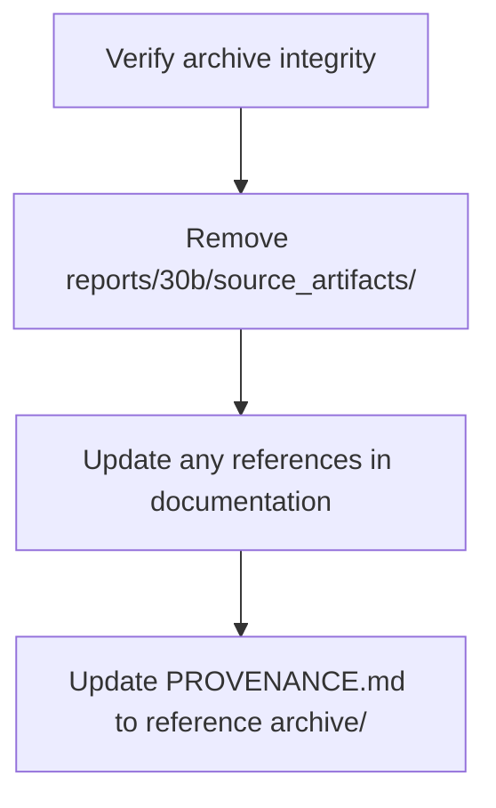
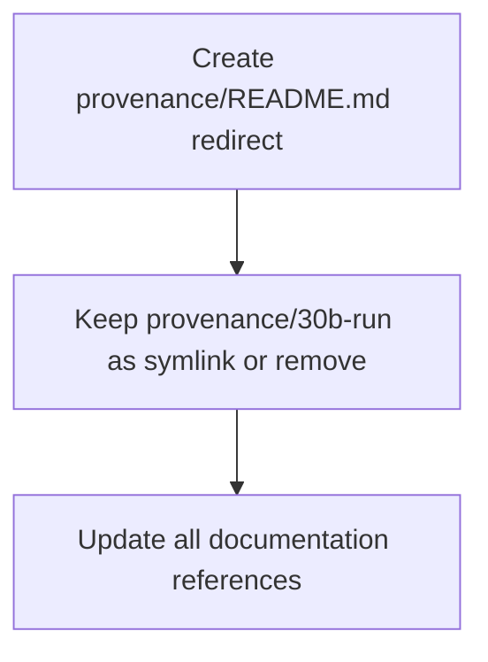
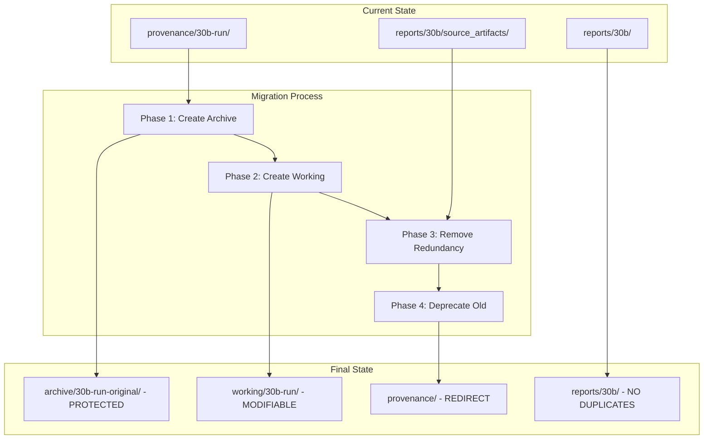

# Architecture Migration Plan: Protected Original 30B Run

**Document Version**: 1.0  
**Created**: 2026-08-08  
**Status**: Design Phase - Pending Implementation

---

## Executive Summary

This document defines a repository restructuring strategy to permanently protect the original 30B training run artifacts while enabling safe modifications. The plan creates a clear separation between **immutable original data** and **mutable working copies**, eliminating redundancy and establishing clear provenance boundaries.

---

## 1. Current State Analysis

### 1.1 Existing Directory Structure

```
terminus-flagship-30b/
├── provenance/
│   └── 30b-run/                          # Original run artifacts
│       ├── RUN_ID.json
│       ├── configs/                      # 8 config files
│       ├── evaluations/                  # Empty directory
│       ├── logs/                         # Training telemetry
│       ├── milestones/final/metrics.json
│       └── source/                       # 6 source files
│
├── reports/
│   └── 30b/
│       ├── *.tex, *.pdf, *.md           # Reports and papers
│       ├── *.py                          # Analysis scripts
│       ├── figures/                      # 11 PDF figures
│       ├── forensic_outputs/             # 9 CSV/JSON outputs
│       ├── preview/                      # 2 PNG previews
│       ├── tables/                       # 6 CSV tables
│       └── source_artifacts/             # DUPLICATE of provenance/30b-run
│           └── fresh-h100-curriculum-30b-rmsmatch-b28-nativealloc-20260731T200059Z/
│               └── [identical structure to provenance/30b-run]
│
└── src/                                  # Production continuation
```

### 1.2 Key Findings

| Finding | Details |
|---------|---------|
| **Duplicate Data** | `reports/30b/source_artifacts/` contains an exact copy of `provenance/30b-run/` |
| **Run ID** | `fresh-h100-curriculum-30b-rmsmatch-b28-nativealloc-20260731T200059Z` |
| **Exit Status** | 0 (successful completion) |
| **Final Validation Loss** | 2.1653283908963203 |
| **Total Tokens** | 29,999,996,928 |
| **Source Files** | 6 files with SHA-256 hashes recorded in PROVENANCE.md |

### 1.3 Problems with Current Structure

1. **Redundancy**: Two identical copies of run artifacts exist
2. **No Protection**: Nothing prevents accidental modification of original data
3. **Unclear Boundaries**: No distinction between original and working data
4. **Risk of Drift**: Modifications could corrupt provenance evidence

---

## 2. Proposed New Structure

### 2.1 Design Principles

1. **Immutability by Convention**: Archive directories are never modified after creation
2. **Clear Naming**: Directory names explicitly indicate protection status
3. **Single Source of Truth**: No duplicate data - one canonical archive location
4. **Working Isolation**: All modifications happen in clearly marked working directories
5. **Documentation at Every Level**: README files explain purpose and rules

### 2.2 New Directory Structure

```
terminus-flagship-30b/
├── archive/                              # PROTECTED - NEVER MODIFY
│   ├── README.md                         # Archive rules and warnings
│   └── 30b-run-original/                 # Canonical original run
│       ├── RUN_ID.json
│       ├── _PROTECTION_LOCK              # Marker file indicating immutability
│       ├── configs/
│       ├── logs/
│       ├── milestones/
│       └── source/
│
├── working/                              # SAFE TO MODIFY
│   ├── README.md                         # Working directory guidelines
│   └── 30b-run/                         # Working copy for modifications
│       ├── configs/
│       ├── logs/
│       ├── milestones/
│       └── source/
│
├── reports/
│   └── 30b/
│       ├── README.md                    # Report provenance documentation
│       ├── *.tex, *.pdf, *.md           # Reports and papers
│       ├── *.py                         # Analysis scripts
│       ├── figures/
│       ├── forensic_outputs/
│       ├── preview/
│       └── tables/
│       # NOTE: source_artifacts/ REMOVED (redundant)
│
├── provenance/                          # DEPRECATED - will be empty
│   └── README.md                        # Redirect to archive/
│
└── src/                                 # Production continuation (unchanged)
```

### 2.3 Directory Purposes

| Directory | Purpose | Modification Policy |
|-----------|---------|---------------------|
| `archive/` | Immutable original data | **NEVER MODIFY** - Read-only archive |
| `working/` | Active modifications | **SAFE TO MODIFY** - Working copies |
| `reports/` | Analysis outputs | **SAFE TO MODIFY** - Generated content |
| `src/` | Production code | **SAFE TO MODIFY** - Active development |
| `provenance/` | Legacy redirect | **DEPRECATED** - Points to archive/ |

---

## 3. Migration Plan

### 3.1 Phase 1: Create Archive Structure



**Steps:**
1. Create `archive/` directory at repository root
2. Copy entire `provenance/30b-run/` to `archive/30b-run-original/`
3. Create `_PROTECTION_LOCK` marker file with timestamp and hash manifest
4. Create `archive/README.md` documenting immutability rules
5. Verify all files match SHA-256 hashes in PROVENANCE.md

### 3.2 Phase 2: Create Working Structure



**Steps:**
1. Create `working/` directory at repository root
2. Copy `archive/30b-run-original/` to `working/30b-run/`
3. Create `working/README.md` documenting intended use

### 3.3 Phase 3: Remove Redundancy



**Steps:**
1. Verify archive contains complete original data
2. Remove `reports/30b/source_artifacts/` directory
3. Update PROVENANCE.md to reference `archive/30b-run-original/`
4. Update README.md to reflect new structure

### 3.4 Phase 4: Deprecate Old Provenance



**Steps:**
1. Create `provenance/README.md` redirecting to `archive/`
2. Either remove `provenance/30b-run/` or replace with symlink to `archive/30b-run-original/`
3. Update all cross-references in documentation

---

## 4. File Operations Summary

### 4.1 Move Operations (Preserve Original)

| Source | Destination | Notes |
|--------|-------------|-------|
| `provenance/30b-run/` | `archive/30b-run-original/` | Primary archive location |

### 4.2 Copy Operations

| Source | Destination | Purpose |
|--------|-------------|---------|
| `archive/30b-run-original/` | `working/30b-run/` | Working copy for modifications |

### 4.3 Delete Operations

| Target | Reason |
|--------|--------|
| `reports/30b/source_artifacts/` | Redundant duplicate of archive |
| `provenance/30b-run/` (optional) | Replaced by archive/ |

### 4.4 Create Operations

| File | Purpose |
|------|---------|
| `archive/README.md` | Document archive rules |
| `archive/30b-run-original/_PROTECTION_LOCK` | Immutability marker |
| `working/README.md` | Document working directory purpose |
| `provenance/README.md` | Redirect to archive/ |
| `reports/30b/README.md` | Document report provenance |

---

## 5. Protection Mechanisms

### 5.1 `_PROTECTION_LOCK` File Format

```json
{
  "protection_status": "IMMUTABLE",
  "locked_date": "2026-08-08T00:00:00Z",
  "lock_reason": "Original 30B training run artifacts - never modify",
  "run_id": "fresh-h100-curriculum-30b-rmsmatch-b28-nativealloc-20260731T200059Z",
  "file_manifest": {
    "source/model.py": "9387fbf0bc773e9f57fc9ea0783be247ba549cc66e6df644fae6c61bb092fdfb",
    "source/kernels.py": "1046c5470a08648f616df8e38cbba47638e33de0b07710d5f3f7377aa082f647",
    "source/data.py": "4781d89f03fc68f377421c1e7ebf38925fd40032fe9d4b5c5762837e3c7f45e8",
    "source/optim.py": "b3f65426f1c9631d43087919d28d2dcbb7655626dace65f507be17fa70f22882",
    "source/train.py": "656013fd446331303c88af140ab95ea624067127bec5c49bae161e37ebf96e77",
    "source/run_h100_e2e.sh": "d2a86e23d9f1fba367861df87605058abfdaeb66931a945993b18a46e62f3e77"
  },
  "warning": "DO NOT MODIFY ANY FILES IN THIS DIRECTORY OR ITS PARENTS"
}
```

### 5.2 Git Attributes (Optional)

Add to `.gitattributes` to prevent accidental commits:

```
archive/** binary
archive/** -diff
archive/** -merge
```

---

## 6. README File Specifications

### 6.1 `archive/README.md`

```markdown
# Archive Directory - PROTECTED

⚠️ **WARNING: THIS DIRECTORY IS IMMUTABLE** ⚠️

This directory contains the original, unmodified artifacts from the 30B training run.
**DO NOT MODIFY, DELETE, OR MOVE ANY FILES IN THIS DIRECTORY.**

## Contents

- `30b-run-original/`: Canonical original training run artifacts

## Rules

1. **No modifications** - Files here must never be edited
2. **No deletions** - Files here must never be removed
3. **No additions** - Do not add new files to this archive
4. **Read-only access** - All access should be read-only

## For Modifications

If you need to modify any artifacts, use the `working/` directory instead.

## Verification

Each directory contains a `_PROTECTION_LOCK` file with SHA-256 hashes.
Verify integrity before and after any repository operations.
```

### 6.2 `working/README.md`

```markdown
# Working Directory

This directory contains working copies of training run artifacts that can be
safely modified for experimentation, analysis, or other purposes.

## Contents

- `30b-run/`: Working copy of the 30B training run artifacts

## Purpose

Use this directory when you need to:
- Modify configuration files for new experiments
- Analyze logs with custom scripts
- Test changes to source code
- Generate new reports or figures

## Original Data

The original, unmodified artifacts are preserved in `../archive/`.
Always reference the archive for ground truth data.
```

### 6.3 `provenance/README.md`

```markdown
# Provenance Directory - DEPRECATED

⚠️ **This directory is deprecated.** ⚠️

The original training run artifacts have been moved to:
- **Archive (protected)**: `../archive/30b-run-original/`
- **Working copy**: `../working/30b-run/`

## Migration

All provenance data is now in the `archive/` directory.
Please update any references to use the new locations.

## Why This Change

This restructuring ensures:
1. Original data is permanently protected from modification
2. Working copies are clearly separated from originals
3. No duplicate data exists in the repository
```

---

## 7. Documentation Updates Required

### 7.1 Files to Update

| File | Changes |
|------|---------|
| `README.md` | Update layout section to reference `archive/` and `working/` |
| `PROVENANCE.md` | Update all paths from `provenance/30b-run/` to `archive/30b-run-original/` |
| `reports/30b/*.md` | Update any hardcoded paths to provenance data |

### 7.2 Path Mapping Reference

| Old Path | New Path |
|----------|----------|
| `provenance/30b-run/` | `archive/30b-run-original/` (original) |
| `provenance/30b-run/` | `working/30b-run/` (for modifications) |
| `reports/30b/source_artifacts/...` | `archive/30b-run-original/` |

---

## 8. Verification Checklist

Before considering migration complete:

- [ ] Archive directory created with complete original data
- [ ] `_PROTECTION_LOCK` file created with hash manifest
- [ ] Working directory created as copy of archive
- [ ] All README files created
- [ ] Redundant `source_artifacts/` directory removed
- [ ] PROVENANCE.md updated with new paths
- [ ] README.md updated with new structure
- [ ] All SHA-256 hashes verified
- [ ] No data loss during migration
- [ ] Git history preserved (if applicable)

---

## 9. Rollback Plan

If issues arise during migration:

1. **Archive not created properly**: Delete `archive/` and restart Phase 1
2. **Working copy corrupted**: Delete `working/` and re-copy from `archive/`
3. **References broken**: Use git to revert documentation changes
4. **Complete rollback**: Restore `provenance/30b-run/` from archive

---

## 10. Mermaid Diagram: Complete Migration Flow



---

## 11. Implementation Notes

### 11.1 Execution Order

1. Create archive first (safest operation)
2. Verify archive integrity before proceeding
3. Create working copy from verified archive
4. Only remove duplicates after verification
5. Update documentation last

### 11.2 Safety Considerations

- **Never delete before verifying**: Always verify archive before removing duplicates
- **Keep git history**: Use git mv where possible to preserve history
- **Test on copy first**: If unsure, test migration on a branch

### 11.3 Post-Migration Validation

After migration, run these checks:

```bash
# Verify archive hashes
cd archive/30b-run-original/source
sha256sum -c ../../../PROVENANCE.md

# Verify working copy matches archive
diff -r archive/30b-run-original working/30b-run

# Verify no references to old paths
grep -r "provenance/30b-run" --include="*.md" .
grep -r "source_artifacts" --include="*.md" .
```

---

## 12. Approval

This plan requires approval before implementation:

- [ ] Plan reviewed by project owner
- [ ] Archive location approved
- [ ] Naming conventions approved
- [ ] Migration timeline agreed
- [ ] Rollback procedure understood

---

**Document Status**: Ready for Review  
**Next Step**: Obtain approval, then switch to Code mode for implementation
